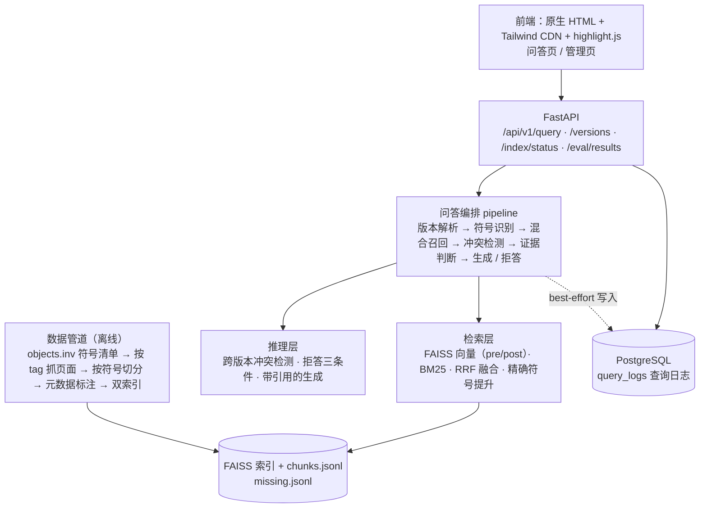

# 版本感知的 Python 库文档问答系统

**同一个问题在不同库版本下答案不同。** 本项目让问答系统识别这种差异：标注答案来自哪个版本、跨版本证据冲突时**不合并也不选最新版**、证据不足时**拒答**，而不是生成一个看似合理的答案。

覆盖范围：pandas `1.5.3` / `2.2.0`，SQLAlchemy `1.4` / `2.0`。文档全部来自各版本官方站点，按 API 符号切分后建立双索引。

## 一句话讲清楚

> Python 生态版本迭代快，通用 RAG 无法判断答案对应哪个版本。本项目把「版本」作为工程约束引入检索链路，并主动牺牲覆盖率换可信度：跨版本证据冲突时输出结构化冲突，证据不足时拒答。

三条主线：

1. **版本进链路**：每个 chunk 携带 `library / version / symbol` 元数据；检索支持 pre-filter（在版本子集内召回）与 post-filter（先召回再过滤），两者都保留并可对比。
2. **冲突不合并**：同一符号跨版本不一致时，输出各版本的说法与来源，交给用户判断。
3. **可验证**：版本敏感评测集，跑三种过滤方式的 Recall@K、状态准确率、冲突误报、误拒答。

## 现状（可直接验收）

| 项 | 结果 |
| --- | --- |
| 语料 | 4 个版本共 **839 个页面**（pandas 823 + SQLAlchemy 18，含重试），切出 **3912 个块** |
| 索引 | FAISS（全局 + 每版本子索引）+ BM25，嵌入 MiniLM 384 维，**3195 个真实块**参与检索，缺失记录单独存放 |
| 评测 | 28 道题 × 3 种过滤模式：`pre` Recall@4 **0.875**、状态准确率 **1.000**；`none` Recall@4 **1.000**；冲突误报 0、漏报 0、误拒答 0 |
| 测试 | `pytest tests` **19 项全部通过** |
| 前端 | 问答页（会话列表 + 版本选择 + 冲突/拒答渲染）、管理页（索引状态 + 评测对比 + 逐题明细） |

评测细节与逐题结果见 [docs/evaluation.md](docs/evaluation.md)。

## 架构



### 数据管道

1. `fetch_docs.py`：先解析各版本文档的 `objects.inv`（Sphinx 的符号清单，权威且比抓 HTML 猜符号可靠），再按清单抓页面。
   pandas 优先抓「跨版本有差异的符号 + 顶层函数 + DataFrame/Series 方法」；SQLAlchemy 抓章节页，一页含多个符号。
2. `build_index.py`：长页面按 `<dl class="py ...">` 切成「一个符号一个块」，抽取签名、参数名、正文、代码示例、弃用标记。
3. 符号在某版本**不存在**时，依据该版本的符号清单生成 `doc_type=missing` 的记录，作为冲突证据保存。

### 在线问答

```
问题 → 版本解析（参数或文本中的版本号）→ 符号识别（形如 a.b.c 的 token）
    → 混合召回（FAISS 向量 + BM25，RRF 融合，版本 pre/post 过滤）
    → 用户点名的符号直接提到最前
    → 跨版本冲突检测（存在性 / 弃用状态 / 参数集合 / 签名）
    → 证据充分性判断 → 生成（强制带 source_url + version）或拒答
```

**冲突检测为什么以结构化字段为主**：文档是自然语言，两个版本的表述是否「矛盾」只能靠模型判断，成本高且不稳定；而「符号是否还存在、是否标记弃用、参数是否增删」都能稳定抽取，也正好是版本变化最实际的信号。

**拒答三条件**（任一成立）：
- 相关性不足：最佳向量相似度低于阈值（`MIN_RELEVANCE`，依据实测分布取值）；
- 符号未覆盖：问题点名了某个 API 符号，但知识库里没有；
- 跨版本冲突且未指定版本：返回结构化冲突，不替用户选择。

## 技术栈

| 层 | 技术 |
| --- | --- |
| 后端 | FastAPI、Pydantic、pydantic-settings、Uvicorn |
| 检索 | FAISS（Inner Product，向量已归一化）、自实现 BM25（k1=1.5, b=0.75）、RRF（k=60） |
| 嵌入 | sentence-transformers `all-MiniLM-L6-v2`（本地，384 维） |
| 生成 | OpenAI 兼容接口（`.env` 里换 `OPENAI_API_BASE` / `OPENAI_MODEL` 即可切到 DeepSeek、Ollama 等） |
| 抓取解析 | httpx、BeautifulSoup4、lxml |
| 数据库 | PostgreSQL 17（Docker）：`query_logs` 记录每次问答的结果、相似度、耗时，供管理页做拒答率与语料缺口分析 |
| 前端 | 原生 HTML + JS，Tailwind CDN，highlight.js；由 FastAPI 静态托管 |
| 测试 | pytest |

## 快速开始

要求：Python 3.13+、[uv](https://docs.astral.sh/uv/)、Docker Desktop（仅数据库健康检查用）。**不需要 Node.js。**

```powershell
# 1. 依赖
uv venv .venv --python 3.14
uv pip sync requirements.txt --python .venv\Scripts\python.exe

# 2. 配置：复制模板后填写 OPENAI_API_KEY
Copy-Item .env.example .env

# 3. 抓文档（约 839 页，首次 10~20 分钟；已抓过的页面会走缓存）
.\.venv\Scripts\python.exe backend\scripts\fetch_docs.py --lib all

# 4. 建索引（切分 + 向量 + BM25，约 1~2 分钟）
.\.venv\Scripts\python.exe backend\scripts\build_index.py

# 5. 评测（可选，生成管理页展示的数据）
.\.venv\Scripts\python.exe backend\scripts\run_eval.py

# 6. 建表（查询日志，需先启动 Docker Desktop 并执行 .\start-db.cmd）
.\.venv\Scripts\python.exe backend\scripts\init_db.py

# 7. 启动
.\start-backend.cmd
```

- 问答页：<http://127.0.0.1:8000/>
- 管理页：<http://127.0.0.1:8000/admin.html>
- API 文档：<http://127.0.0.1:8000/docs>

首次运行会从 Hugging Face 下载约 90MB 的嵌入模型；国内网络请在 `.env` 保留 `HF_ENDPOINT=https://hf-mirror.com`。

## API

| 方法 | 路径 | 说明 |
| --- | --- | --- |
| POST | `/api/v1/query` | 版本感知问答 |
| GET | `/api/v1/versions` | 支持的库与版本，及每个版本的索引块数 |
| GET | `/api/v1/index/status` | 索引状态（块数、维度、按版本分布） |
| GET | `/api/v1/eval/results` | 最近一次评测结果 |
| GET | `/api/v1/query/logs` | 最近查询与聚合（总数、各状态计数、拒答率、平均耗时），数据来自 PostgreSQL |
| GET | `/api/health`、`/api/health/db` | 服务 / 数据库连通检查 |

请求示例：

```json
POST /api/v1/query
{"query": "DataFrame.append 怎么用？", "library": "pandas", "version": "2.2.0", "mode": "pre", "top_k": 4}
```

响应 `status` 三种取值：

```json
{"status": "answer",   "answer": "...", "citations": [{"version": "2.2.0", "symbol": "...", "source_url": "..."}]}
{"status": "conflict", "answer": "...", "conflicts": [{"symbol": "...", "reasons": ["..."], "claims": [{"version": "1.5.3", "exists": true, "deprecated": true, "text": "..."}]}]}
{"status": "refused",  "answer": "文档中没有足够信息回答这个问题，因此不作推测。", "reasons": ["..."]}
```

索引未构建时返回 `503`；超过每分钟提问次数（`RATE_LIMIT_PER_MINUTE`，默认 20，按 IP 计）返回 `429`；未配置可用的大模型时自动退化为「文档原文摘录」模式，并在 `meta.used_llm=false` 中标明。

## 部署

项目提供 `Dockerfile`，可部署到 Render / Railway 等平台，也可用 `docker compose --profile app up -d --build` 部署到自有服务器。
步骤、需要提交的文件清单与环境变量见 [docs/deployment.md](docs/deployment.md)。

CI：`.github/workflows/ci.yml` 在每次 push 时安装锁定依赖并运行 `pytest`。

## 项目结构

```text
backend/
  app/
    api/v1/endpoints/     query / versions / eval 路由
    ingestion/            inventory.py（objects.inv 解析）、fetcher.py、chunker.py
    retrieval/            embeddings.py、vector_store.py（FAISS）、bm25_store.py、fusion.py（RRF）、hybrid.py
    reasoning/            conflict.py、sufficiency.py、generator.py
    schemas/              Pydantic 请求响应模型
    core/                 LLM 客户端与异常
    pipeline.py           问答编排
    config.py             配置与版本白名单
    db/                   schema.sql（query_logs 建表）、repository.py（psycopg 数据访问）
    main.py               应用入口、静态托管
  static/                 index.html（问答）、admin.html（管理）、js/common|chat|admin.js
  scripts/                fetch_docs.py、build_index.py、run_eval.py、init_db.py
  data/
    raw/                  按版本抓取的原始页面 + manifest.json
    processed/chunks.jsonl
    index/vector/         FAISS 索引 + chunks.jsonl + missing.jsonl
    index/bm25/           BM25 倒排
    eval/                 questions.jsonl、results.json
tests/                    test_chunker / test_conflict / test_api
docs/                     evaluation.md、decisions.md
```

## 验证与验收

```powershell
# 单元测试
.\.venv\Scripts\python.exe -m pytest tests -q

# 重跑评测（会重新计算三种过滤模式的指标）
.\.venv\Scripts\python.exe backend\scripts\run_eval.py
```

## 已知局限

- 语料是**抽样**而非全量：pandas 官方 API 有 2023~2307 个符号，本项目抓了 443/380 页（优先选跨版本有差异的符号），因此不在语料内的符号会被明确拒答。
- 只有 pandas 的**类方法页**是逐符号切分；SQLAlchemy 按章节页切分，符号粒度对齐但页面级证据粒度较粗。
- 冲突检测只看结构化字段，两个版本「措辞不同但语义一致」不会被识别；「措辞相同但语义不同」也可能漏判。
- 嵌入模型偏英文；中文提问可以工作，但换成中文模型（如 `bge-small-zh`）效果会更好——**换模型必须重建索引**。
- 没有会话持久化到服务端（会话存在浏览器 localStorage）、没有用户认证、没有 CI。
- 未做重排序（rerank）；混合检索目前只有 RRF 一种融合方式。

## 相关文档

- [docs/evaluation.md](docs/evaluation.md)：评测方法、结果表与逐题分析
- [docs/decisions.md](docs/decisions.md)：技术取舍（ADR）
